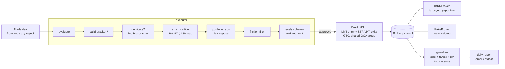

# ibkr-risk-guard

[](https://github.com/OWNER/ibkr-risk-guard/actions/workflows/ci.yml)


Pre-trade risk checks and a protection guardian for **Interactive Brokers paper accounts**.

This is the risk layer I extracted from a semi-automated equity trading system I ran on a
real account. **It contains no trading strategy.** It never decides *what* to trade. It
decides whether a trade someone else proposed is allowed, sizes it, sends it as an
OCA-linked bracket and, afterwards, checks every position is still protected.

> Paper only, by design. The adapter refuses live ports (7496/4001) and any account
> that doesn't start with `DU`. Both checks are enforced in code and covered by tests.

## Why this exists

Every rule here comes from a failure that cost money in the original system:

| Incident | Rule it produced |
|---|---|
| Sizing code forced `max(1, qty)`, so one share of a volatile stock risked 2.3% instead of 1% | Skip trades where one share exceeds 1.5x the risk budget; never force |
| One $1,349 share entered a ~$5.6k account (24% of NAV) because the cap only checked risk, not concentration | Separate concentration cap; skip if one share doesn't fit |
| 16 individually valid trades added up to 214% gross exposure | Aggregate caps on portfolio risk and gross exposure, checked right before sending |
| A trade was duplicated because state changed between seeing the idea and confirming it | Duplicate check against the broker, live, immediately before placing |
| ~65% of a year's losses were costs (commissions, spreads, fees), not bad picks | Friction filter: reject when costs eat more than half the assumed edge |
| A 2:1 split made the broker cancel protective orders; the repair job re-placed them with **pre-split** levels, and the sell stop fired at once | Market-coherence check before any protective order is placed or repaired |
| Silent failures went unnoticed for days | Daily report sent even on quiet days, so its absence is the alarm |

## Architecture



Everything above the `Broker` protocol is pure Python with no I/O, which is why the full
suite runs in well under a second without TWS.

| Module | Responsibility |
|---|---|
| `risk.py` | Pure math: sizing, aggregate caps, friction |
| `levels.py` | "Would this protective order fire the moment it's placed?" |
| `executor.py` | Ordered pre-trade checks, bracket construction with explicit OCA |
| `guardian.py` | Detects unprotected, half-protected, mismatched and incoherent positions; optional safe repair |
| `report.py` | Read-only daily summary; SMTP settings from env vars only |
| `ibkr.py` | `ib_async` adapter with the paper-only lock |
| `broker.py` | `Broker` protocol and deterministic `FakeBroker` |

## Quick start

```bash
git clone https://github.com/OWNER/ibkr-risk-guard && cd ibkr-risk-guard
python -m venv .venv && source .venv/bin/activate   # Windows: .venv\Scripts\activate
pip install -e ".[dev]"
pytest
risk-guard demo        # offline walkthrough, no broker needed
```

Against an IB Gateway **paper** session (port 4002, or TWS paper on 7497):

```bash
pip install -e ".[ibkr]"
cp .env.example .env    # then export the values, or set them in your shell
risk-guard check AAPL LONG 190 185 200          # dry run: checks only
risk-guard check AAPL LONG 190 185 200 --send   # places the bracket on the paper account
risk-guard guard                                # audit protection, exit code 1 if anything is wrong
risk-guard report                               # print the daily report
risk-guard report --send                        # email it (SMTP_* env vars)
```

## Design decisions

- **Unknown state blocks risk, not protection.** If portfolio risk or exposure can't be
  read, new trades are rejected. If a quote can't be read, protective orders are still
  placed, because being unprotected is worse.
- **Explicit OCA on both exits**, in addition to the parent link, so one exit filling
  always cancels the other.
- **Repairs never trust stored levels blindly.** Stale levels are reported, not placed.
- **Caps are ceilings, not targets.** `RiskConfig` validates its own values.

## Limitations

- US stocks via `SMART` routing only.
- The friction filter needs an assumed edge (`expected_edge_r`). It's a cost/benefit
  guard, not evidence that any strategy has an edge.
- Not financial advice. Paper trading only.

## License

MIT
